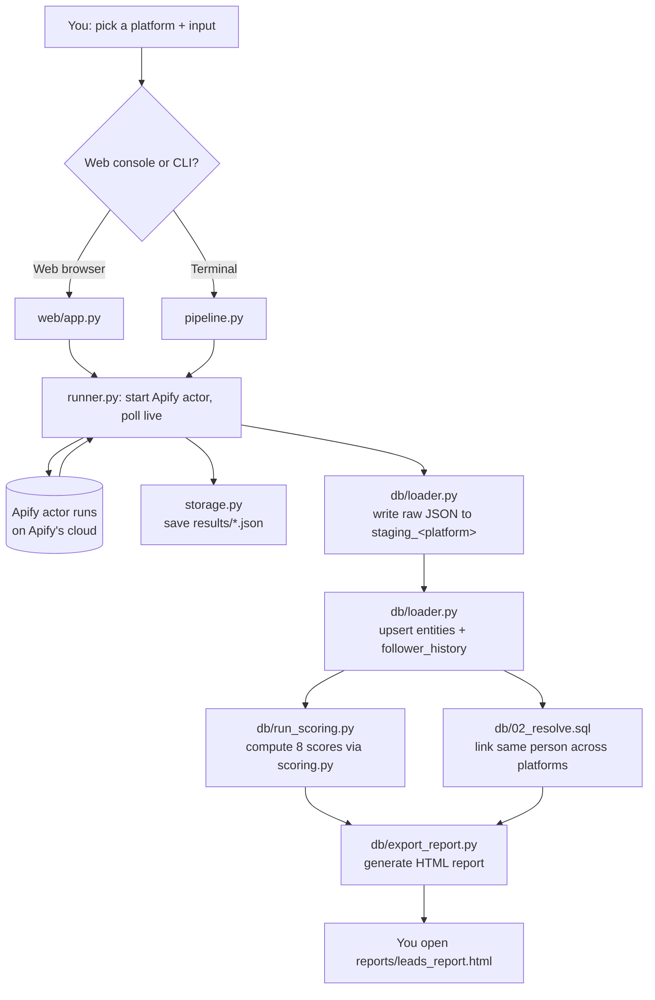
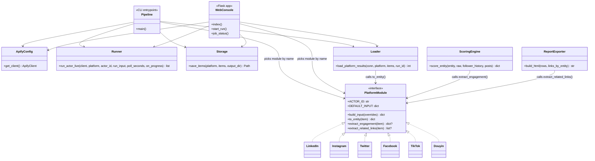

# IB Discovery & Scoring Pipeline

Finds potential Introducing Brokers (IBs) / affiliates on social media via Apify, stores them in a local Postgres database, links the same person across platforms, and scores each one as a prospect.

## What this app does

1. **Scrapes profiles** from LinkedIn, Instagram, Twitter/X, Facebook, TikTok, or Douyin using Apify actors.
2. **Stores everything** in Postgres: raw JSON (forever, for audit) + a cleaned-up "entities" table (one row per person per platform).
3. **Links the same person across platforms** when there's evidence (matching phone, email, website, or bio/handle mentions) — see `db/02_resolve.sql`.
4. **Scores every entity** as a potential IB across 8 signals (relevance, brand safety, engagement, etc.) — see `scoring.py`.
5. **Exports a readable report** (HTML, clickable links) you can open in a browser.

There are two ways to use it: a **web console** (click buttons, no code) or the **command line** (scriptable).

---

## Flow chart



## Class diagram

Python here is mostly modules with a consistent function contract rather than deep class hierarchies — this shows that contract: every `platforms/*.py` file implements the same shape, and the rest of the app is built against that shape, not against any one platform.



---

## One-time setup

Already done on this machine, listed here so you know what exists:

- Python 3.12 + a virtual environment at `.venv\`
- All dependencies installed (`requirements.txt`)
- A local Postgres 17 server (portable install, not a Windows service — see "Starting Postgres" below) at `%LOCALAPPDATA%\Programs\pgsql17\pgsql`, database name `ib_discovery`
- Schema applied (tables: `staging_<platform>`, `entities`, `entity_links`, `entity_scores`, `entity_follower_history`)
- `.env` holds your Apify token + database connection string (never commit this file — it's gitignored)

If you ever need to reapply the schema from scratch:
```
.\.venv\Scripts\python.exe db\run_sql_file.py db\01_schema.sql
.\.venv\Scripts\python.exe db\run_sql_file.py db\04_scores.sql
.\.venv\Scripts\python.exe db\run_sql_file.py db\05_follower_history.sql
.\.venv\Scripts\python.exe db\run_sql_file.py db\07_staging_telegram.sql
```

### Starting Postgres

Postgres runs as a plain background process here (not a Windows service, since this machine doesn't have admin rights to install one). **It does not start automatically** — run this once per computer restart:
```
.\db\start_postgres.ps1
```
It's safe to run even if already running (just prints "accepting connections").

## Telegram discovery worker

Telegram discovery is a separate async worker. It reads public channels/groups only,
does not join private links or fetch participants, and resumes its bounded frontier
from `.telegram_frontier.json` after an interrupted run.

1. Create `api_id` and `api_hash` at `my.telegram.org` using a dedicated secondary number.
2. Set `TELEGRAM_API_ID` and `TELEGRAM_API_HASH` locally, then create the session:
    `\.\.venv\Scripts\python.exe telegram_auth_setup.py`
    If the terminal is inconvenient, launch `telegram_auth_gui.py` instead and enter the OTP in its local window.
3. Store the printed `TELEGRAM_SESSION` as a secret. Set `TELEGRAM_SEEDS` to comma-separated public usernames/`t.me` links and `DATABASE_URL`.
4. Run from `a-function`:
    `\.\.venv\Scripts\python.exe -m discovery.telegram.crawl`

Optional limits are `TELEGRAM_MAX_DEPTH`, `TELEGRAM_MAX_CHANNELS_PER_RUN`,
`TELEGRAM_MSG_SCAN_LIMIT`, `TELEGRAM_FLOOD_ABORT_SECONDS`, and `TELEGRAM_MIN_SLEEP`.
Export staging rows as JSONL and compare them with `scripts/telegram_coverage_report.py`.

## YouTube Data API v3 discovery

YouTube discovery uses Google's Data API directly, not Apify. Add a restricted
API key with **YouTube Data API v3** enabled to `.env`:

```text
YOUTUBE_API_KEY=your_key_here
```

Run a keyword search:

```powershell
.\.venv\Scripts\python.exe -m discovery.youtube_data_api "forex Việt Nam" "đào tạo IB" --max-results 25
```

`search.list` costs 100 quota units per keyword and `channels.list` costs 1
unit per batch of up to 50 channels. Raw results are saved to
`staging_youtube`, mapped to `entities`, and the result JSON records
`quota_units`. Tests mock the API and consume no Google quota.

---

## How to use it — Web console (easiest)

1. Make sure Postgres is running (see above).
2. Start the app:
   ```
   .\.venv\Scripts\python.exe web\app.py
   ```
3. Open **http://127.0.0.1:5000** in your browser.
4. Pick a **platform** from the dropdown (linkedin / instagram / twitter / facebook / tiktok / douyin), or leave it on "custom" and type any Apify actor ID yourself.
5. Edit the **Run Input JSON** if you want (search terms, usernames, max items, etc.) — it's pre-filled with a sensible default, or whatever you ran last time for that platform.
6. Click **Run actor**. You'll see live status (`RUNNING - 12 items scraped so far...`) until it finishes.
7. Results show as a table, save to `results/<platform>_results.json`, and (for the 6 built-in platforms) automatically load into Postgres too.

To stop the app, close its terminal / stop the background process.

**Login required.** Every route redirects to `/login` until you sign in — see "Web console login" below for one-time setup.

---

## Web console login

Each person gets their own username/password + their own Apify API token — runs
they start bill to their own token, not a shared one.

One-time setup:
1. Add schema: `.\.venv\Scripts\python.exe db\run_sql_file.py db\06_users.sql`
2. Generate two secrets and put them in `.env`:
   ```
   python -c "import secrets; print(secrets.token_hex(32))"          # SECRET_KEY
   python -c "from cryptography.fernet import Fernet; print(Fernet.generate_key().decode())"  # TOKEN_ENC_KEY
   ```
3. Set `ADMIN_USERNAME` / `ADMIN_PASSWORD` / `ADMIN_APIFY_TOKEN` in `.env`, then run:
   ```
   .\.venv\Scripts\python.exe db\seed_admin.py
   ```
4. Log in as that admin, then use **Admin** (top nav) to add/remove other users —
   each gets their own password and their own Apify token, pasted in at creation
   time. Tokens are encrypted at rest (`TOKEN_ENC_KEY`); losing that key makes
   stored tokens unrecoverable, so back it up alongside `DATABASE_URL`.

The CLI (`pipeline.py`, `db/*.py`) is unaffected — it keeps reading the shared
`APIFY_TOKEN` from `.env` as before; only the web console is per-user.

---

## How to use it — Command line

Scrape a platform:
```
.\.venv\Scripts\python.exe pipeline.py --platform linkedin
.\.venv\Scripts\python.exe pipeline.py --platform tiktok
.\.venv\Scripts\python.exe pipeline.py --platform all          # every platform, one after another
```

Useful flags:
- `--search-query "your search"` — override the default search term (linkedin/twitter/facebook/facebook_post/tiktok/douyin — Douyin now searches by keyword, it no longer needs a profile URL)
- `--usernames user1 user2` — scrape specific people instead of searching (instagram/tiktok/twitter)
- `--urls https://...` — scrape specific profile URLs (instagram)
- `--no-db` — skip the Postgres load, JSON file only

### Two Facebook channels

- `--platform facebook` searches **Pages** (`apify/facebook-search-scraper`). On Facebook these are mostly brokers' own official pages, so it's best treated as *broker/competitor landscape*, not IB discovery.
- `--platform facebook_post` searches public **posts** by keyword (`scraper_one/facebook-posts-search`) and records each post's **author** — the individual people posting about forex/XTB, i.e. the actual IB candidates — with per-post engagement. Authors land in `staging_facebook_post` / `entities.platform = 'facebook_post'` (apply `db/08_staging_facebook_post.sql` once).

### Douyin gold-market channel

One command runs the gold-analyst discovery channel end to end — scrape → stage/entities → filter gate — for **mid-tier** creators (500–5k followers by default):
```
.\.venv\Scripts\python.exe -m discovery.douyin
```
- Keywords come from `inputs\douyin_gold_midtier.json` (黄金分析 / 现货黄金 / XAUUSD …); override with `--keywords 黄金分析 现货黄金` or point `--preset` at another JSON.
- Follower window is `--min-followers 500 --max-followers 5000`; the gate also needs a gold/forex relevance signal in the bio (see `scoring.RELEVANCE_KEYWORDS`, which now covers gold + Chinese trading terms), so off-niche accounts are dropped before any paid enrichment.
- `--no-db` writes only the raw JSON.

Then rank the gated set into a contactable shortlist (email/phone are only what creators published in their own bio):
```
.\.venv\Scripts\python.exe -m discovery.shortlist --platforms douyin --market cn --min-followers 500
```

### IB shortlist

Turn everything discovered into a ranked, deduped shortlist for one broker + market (drops the broker's own pages, rival brokers, and out-of-market accounts):
```
.\.venv\Scripts\python.exe -m discovery.shortlist --broker xtb --market vn --exclude-dir results\2026-09\2026-09-16 --top 10
```
Edit the broker exclusion list in `discovery/data/broker_brands.txt` (one brand per line, no code change needed).

Score everyone currently in the database:
```
.\.venv\Scripts\python.exe db\run_scoring.py
```

Export a readable report (HTML, opens in any browser):
```
.\.venv\Scripts\python.exe db\export_report.py
.\.venv\Scripts\python.exe db\export_report.py --platform tiktok --output reports\tiktok_leads.html
```

Typical workflow for a new batch:
```
.\.venv\Scripts\python.exe pipeline.py --platform tiktok
.\.venv\Scripts\python.exe db\run_scoring.py
.\.venv\Scripts\python.exe db\export_report.py
```
Then open `reports\leads_report.html`.

---

## Reading the report

Each row is one person, ranked by **composite score** (green ≥70, yellow 40–69, red <40):

| Column | Meaning |
|---|---|
| Relevance | 0–100, how well their bio matches forex/IB keywords (real, keyword-based) |
| Brand Safety | 0–100, crude scam-language keyword screen (not real content moderation) |
| Audience Quality | 0–100, weak follower/connections ratio proxy |
| Engagement | % — **real** for TikTok/Twitter (computed from actual post likes/comments/shares); blank for platforms without post data |
| Growth | % change in followers since the last time they were scraped — blank until scraped twice |
| Est. Post Price | Rough $/1000-followers ballpark, nudged by engagement rate when available — not a real market quote |
| Completeness | % of the 7 scoring fields that had real data — a low number means the composite score is resting on fewer signals |
| Related Links | Employer pages / bio-mentioned URLs, plus other-platform accounts once the same person is matched across platforms |

**Two fields are intentionally always blank right now**: audience demographics and fake/inorganic-follower detection. No cheap way to compute these honestly exists in-house — the only real options are paid third-party Apify actors (researched, not yet wired up; ask if you want to revisit).

---

## Project layout

```
pipeline.py          CLI entrypoint
apify_config.py       Apify token/client
runner.py             starts an actor run, polls it live
storage.py             saves results to results/<platform>.json
scoring.py             the 8-signal scoring logic
platforms/            one file per social network (actor ID, field mapping, engagement/links extraction)
db/
  01_schema.sql        staging + entities + entity_links
  02_resolve.sql        cross-platform identity matching
  04_scores.sql         entity_scores table
  05_follower_history.sql   follower-count snapshots over time
  06_users.sql            app_users table (web console login)
  seed_admin.py           one-time: creates the first admin user
  connection.py         Postgres connection
  loader.py              writes scrape results into staging + entities
  run_scoring.py          computes scores for everyone in the DB
  export_report.py         generates the HTML report
  start_postgres.ps1        starts the local Postgres process
web/                   the browser-based console (Flask)
  crypto_utils.py         encrypts/decrypts per-user Apify tokens at rest
results/               raw JSON per scrape (gitignored)
reports/                generated HTML reports (gitignored — contains real people's data)
```
